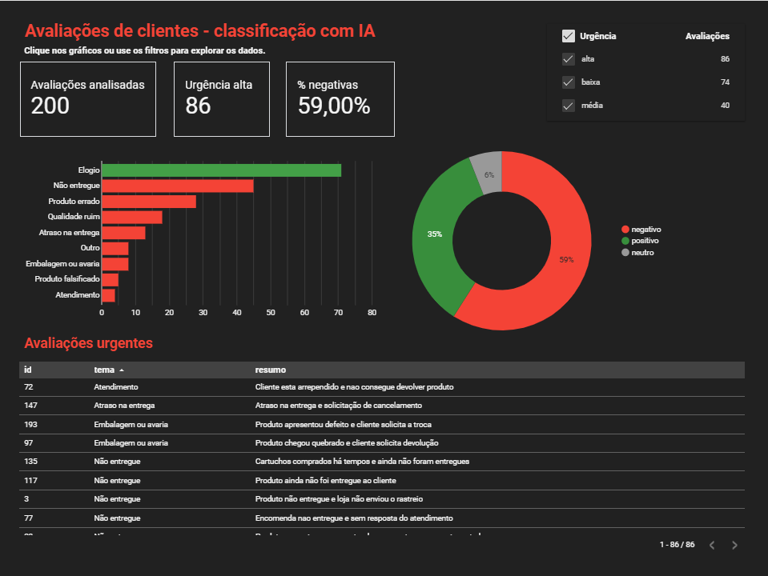
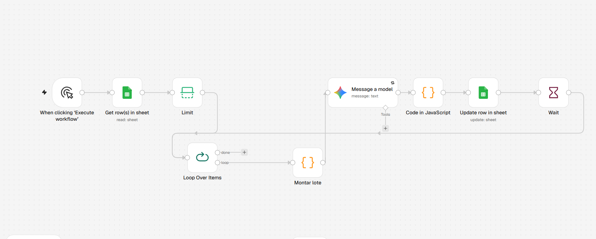
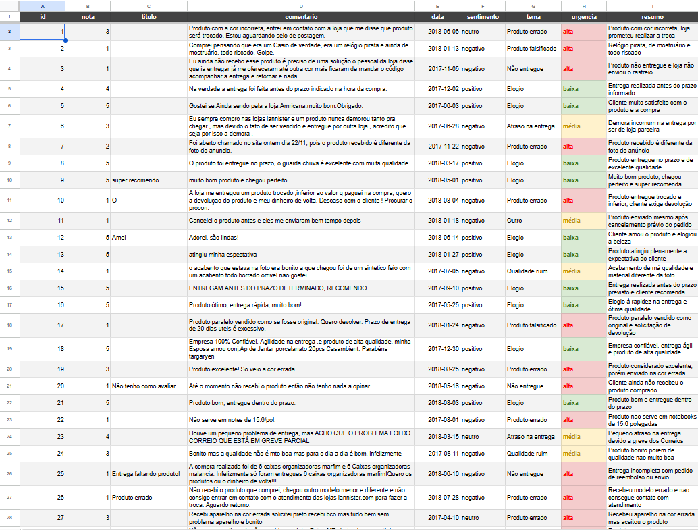

# Analisador de Avaliações com IA

Automação que lê avaliações reais de clientes, usa IA para classificar cada uma por **sentimento, tema e urgência**, e alimenta um **dashboard interativo** com os principais motivos de insatisfação.

**[Ver o dashboard ao vivo](https://datastudio.google.com/reporting/53e2f0be-560e-4e9a-8bf6-75e771aec6e7)** · **[Vídeo de demonstração](https://youtu.be/80bQ_nQ9qq4)**



---

## O problema

Empresas de e-commerce e delivery recebem milhares de avaliações, e ninguém consegue ler todas. As reclamações urgentes se perdem no meio dos elogios, e os padrões (atrasos, produtos errados, pedidos que nunca chegam) demoram a aparecer.

Trabalhei 11 anos com atendimento ao cliente, negociação e resolução de problemas, e sei como uma reclamação sem resposta vira um cliente perdido. Este projeto automatiza a primeira leitura: a IA classifica, e as pessoas focam no que é urgente.

## A solução



1. **Dados:** 200 avaliações reais, em português, do [Brazilian E-Commerce Public Dataset by Olist](https://www.kaggle.com/datasets/olistbr/brazilian-ecommerce) (Kaggle), organizadas no Google Sheets.
2. **Automação (n8n):** o fluxo lê a planilha, agrupa as avaliações em lotes de 10, envia cada lote ao **Google Gemini** com um prompt de regras de negócio e grava as classificações de volta na planilha.
3. **Dashboard (Data Studio):** indicadores, gráficos e filtros interativos conectados à planilha, que se atualizam automaticamente.



## Regras de classificação

O prompt define uma lista fixa de temas, para a IA não inventar categorias e o dashboard ficar consistente:

| Tema | Urgência |
| --- | --- |
| Não entregue, Produto falsificado, Produto errado | alta |
| Atraso na entrega, Embalagem ou avaria, Qualidade ruim, Atendimento | média |
| Elogio | baixa |

Regras de negócio que vieram da minha experiência com atendimento:

- **Produto errado é urgência alta**, porque é o ponto em que o cliente pede reembolso.
- **Se a loja já resolveu ou prometeu resolver** (troca, reenvio, reembolso), o sentimento é **neutro**, e não negativo: um bom atendimento muda a percepção do cliente mesmo quando o produto falhou.
- **Quando a avaliação cita mais de um problema**, a IA escolhe o mais grave como tema.

O prompt completo está em [`prompts/prompt.txt`](prompts/prompt.txt).

## Resultados

- **200 avaliações** classificadas automaticamente.
- **Conferência manual:** revisei 30 classificações (amostra com notas de 1 a 5, nos dois modelos usados) e concordei com o tema e a urgência de todas.
- **Principal achado:** entre as avaliações com problema, **"não entregue" foi o motivo mais frequente (45)**, seguido de produto errado (28) e qualidade ruim (18). O maior problema é de logística, e não do produto em si.
- **86 avaliações** foram marcadas como urgência alta, prontas para o time de atendimento priorizar.

> A amostra foi montada com mais avaliações negativas do que existem na base original (80 negativas, 40 neutras e 80 positivas), para ter casos suficientes de cada problema. Por isso, as proporções do dashboard refletem a amostra, e não a base completa.

## Desafios e como resolvi

| Desafio | Solução |
| --- | --- |
| O plano gratuito do Gemini permite só 5 chamadas por minuto e 20 por dia | Agrupei as avaliações em **lotes de 10** (200 avaliações em 20 chamadas, em vez de 200) e coloquei uma **pausa de 13 segundos** entre os lotes |
| Falhas temporárias da API | Ativei **novas tentativas automáticas** (Retry On Fail) no nó da IA |
| O serviço deixou de responder em um dos modelos | Investiguei pelo painel de cota (as chamadas chegavam, mas nenhum token era processado) e pelo erro real com as novas tentativas desligadas; confirmei que era instabilidade do serviço e troquei do Gemini 3.8 Flash para o 3.6 Flash |
| A IA às vezes devolvia JSON com defeito (aspas dentro dos textos) | Ajustei o prompt e escrevi um código com **plano A e plano B**: se a lista inteira falha, o código lê avaliação por avaliação e aproveita as que estiverem certas. As que falham são marcadas como "ERRO - revisar" e reprocessadas com um filtro, sem refazer o resto |
| Erros que a conferência por amostra não pegou | O próprio dashboard revelou 1 avaliação com o sentimento trocado e valores de urgência escritos de forma diferente; corrigi na planilha |

## Tecnologias

- **n8n:** orquestração da automação
- **Google Gemini API** (3.8 Flash e 3.6 Flash): classificação com IA
- **JavaScript:** nós de código para montar os lotes e tratar as respostas
- **Google Sheets:** base de dados e fórmulas
- **Data Studio (antigo Looker Studio):** dashboard interativo
- **Prompt engineering:** papel, regras de negócio, lista fixa de categorias e saída em JSON

## Estrutura do repositório

```
├── dados/       avaliações com as classificações da IA (.csv)
├── fluxo/       fluxo do n8n, pronto para importar (.json)
├── imagens/     prints do fluxo, da planilha e do dashboard
└── prompts/     prompt usado na classificação
```

## Como reproduzir

1. Importe [`fluxo/analisador-avaliacoes-ia.json`](fluxo/analisador-avaliacoes-ia.json) no n8n (**Import from file**).
2. Crie uma planilha no Google Sheets com as colunas `id`, `nota`, `titulo`, `comentario`, `data`, `sentimento`, `tema`, `urgencia` e `resumo`.
3. Conecte sua conta Google e uma chave da API do Gemini (gratuita no [Google AI Studio](https://aistudio.google.com)).
4. Execute o fluxo. Comece com poucas avaliações no nó **Limit** para testar.

## Próximos passos

- Gerar uma **resposta sugerida** para cada avaliação urgente, pronta para o atendimento revisar e enviar.
- Rodar o fluxo na base completa da Olist, com cerca de 99 mil avaliações.
- Recriar o dashboard no **Power BI**.

---

Feito por **Hellen Mayara**, estudante de Sistemas de Informação, em transição de carreira para tecnologia.
